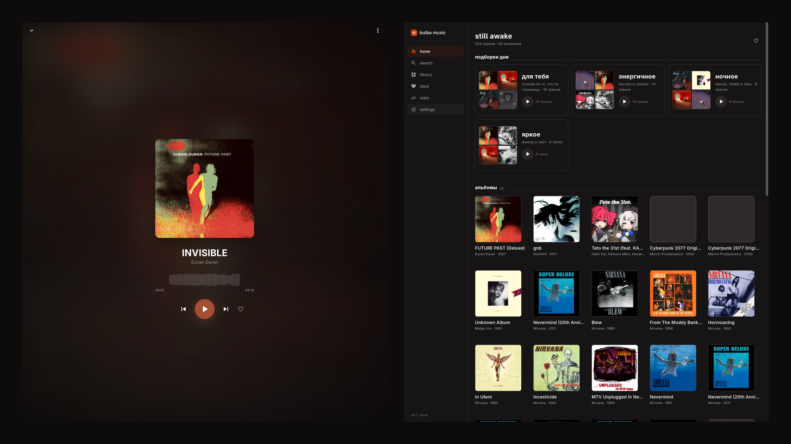
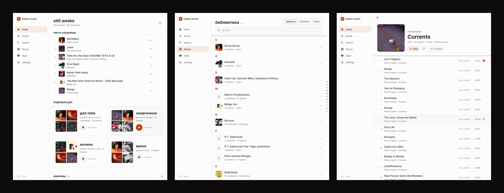

<div align="center">


# bulba music

**Своя музыка. Свой сервер. Свои рекомендации.**

Не облако с чужой библиотекой, а замена Spotify, которую ты держишь у себя:
FLAC-мастера на диске, телефон как тонкий клиент по Tailscale, и подборки,
посчитанные из того, что ты правда слушаешь.

</div>



---

## Что внутри

| | |
|---|---|
| **Библиотека** | FLAC навсегда мастером. Формат виден в каждой строке: `[flac]`, `[320]`, `[aac]`. Lossy никогда не перекодируется в lossy. |
| **Индекс** | Артисты и альбомы по буквам, рейка справа с теми буквами, что реально есть. Страница артиста: альбомы по годам и то, что ты правда переслушиваешь. |
| **Трафик** | Opus 96/128/160 по требованию, всегда из FLAC-мастера; обложки — webp 512 px (65 КБ вместо 2 МБ). |
| **Плеер** | Волна в обе стороны от центра, перемотка тапом, кроссфейд на двух деках по равномощной кривой, gapless. |
| **Цвет** | Обложка — единственный источник акцента: палитра вынимается из арта и переходит на весь интерфейс за 420 мс. |
| **Рекомендации** | Эмбеддинги из звука, четыре оси (темп, яркость, громкость, мажор/минор), дневные подборки по настроению, вкус как центроид из прослушиваний, скипов и лайков. |
| **Аккаунты** | Двенадцать слов вместо пароля. Те же слова на телефоне — один слушатель с общей историей. В базе только хеш. |
| **Ссылки** | `/a/8`, `/al/9` — серверные страницы, открываются в браузере телефона. |



---

## Архитектура

```
┌────────────┐   Tailscale    ┌──────────────────────────────┐
│ телефон    │───────────────▶│  server (Rust)               │
│ Flutter    │  HTTP + Range  │  axum · SQLite · FTS5        │
└────────────┘                │  scan · tags · features      │
                              │  recs · server pages         │
┌────────────┐                └──────────────┬───────────────┘
│ десктоп    │───────────────────────────────┘
│ Flutter    │                library/  Artist/Album (Year)/NN - Title.flac
└────────────┘
```

- **Сервер владеет диском.** Сканирует библиотеку при старте и каждые 5 минут.
  Клиент не знает, что такое папка.
- **Один код клиента** на Android, Linux и macOS (Flutter + media_kit).
- **Один бинарь сервера**, SQLite в WAL, без внешних сервисов.

## Быстрый старт

```sh
git clone https://github.com/sehaxe/bulba-music
cd bulba-music

# сервер
cd server && cargo run --release -- --library ~/bulba-music/library

# клиент
cd ../app && flutter run -d linux
```

Библиотека — просто папка `library/` рядом с проектом (в git её нет).
Телефон: `docs/phone.md`, там Tailscale, APK и вход по фразе.

## Скачать

Готовые сборки — в [releases](https://github.com/sehaxe/bulba-music/releases):

- **Android** — `bulba-music-v0.0.3-arm64.apk`
- **Linux** — `bulba-music-v0.0.3-linux-x64.tar.gz`
- **Server** — `bulba-music-server-v0.0.3-linux-x64`

## Как считаются рекомендации

1. **Кандидаты** — kNN по эмбеддингу текущего трека и по центроидам вкуса.
2. **Скоринг** — косинус к сиду, к вкусу, знакомство с артистом, новизна,
   совпадение по темпу, штраф за недавний скип.
3. **Диверсификация** — не больше двух треков на артиста, без сыгранного за
   семь дней.
4. **Разнообразие** — MMR: релевантность минус повтор, с долей исследования.
5. **Арка** — порядок по энергии, а не «набор треков».

Вкус обновляется от прослушиваний, скипов раньше 20 % и лайков. Скип весит
больше лайка: поведение честнее, чем кнопка.

## Тесты

```sh
cd server && cargo test      # 60+ тестов, без сети
cd app   && flutter test     # геометрия волны, перемотка, кроссфейд
```

## Статус

0.0.1 — играет, качает, листает, считает подборки. В планах: скачивание
офлайн на телефон, синхронная лирика, стемы (вокал поверх инструментала),
серверный A/B рекомендаций.

## Лицензия

MIT
