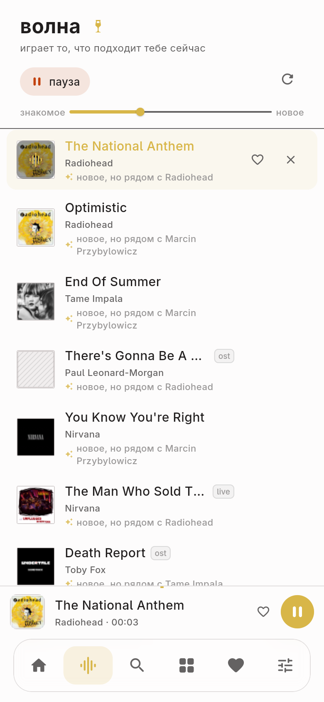
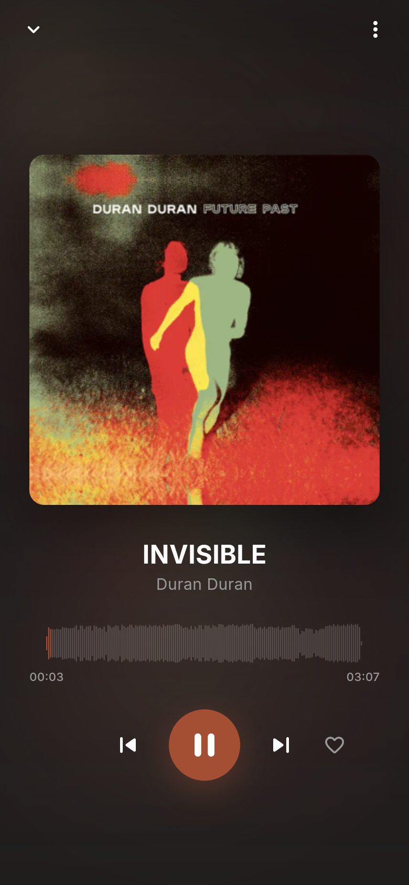

<div align="center">


# bulba music

**Своя музыка. Свой сервер. Свои рекомендации.**

Не облако с чужой библиотекой, а замена Spotify, которую ты держишь у себя:
FLAC-мастера на диске, телефон как тонкий клиент по Tailscale, и подборки,
посчитанные из того, что ты правда слушаешь.

</div>


---

## Что внутри

| | |
|---|---|
| **Библиотека** | FLAC навсегда мастером. Формат виден в каждой строке: `[flac]`, `[320]`, `[aac]`. Lossy никогда не перекодируется в lossy. |
| **Индекс** | Артисты и альбомы по буквам, рейка справа с теми буквами, что реально есть. Страница артиста: альбомы по годам и то, что ты правда переслушиваешь. |
| **Трафик** | Opus 96/128/160 по требованию, всегда из FLAC-мастера; обложки — webp 512 px (120 КБ вместо 755 КБ PNG). JPEG XL отдаётся по `?fmt=jxl` — см. ниже, почему клиент его не просит. |
| **Волна** | Бесконечный поток: каждая следующая песня считается из твоих прослушиваний, дослушиваний, скипов и лайков, и каждая строка объясняет, почему она здесь. |
| **Плеер** | Волна в обе стороны от центра, перемотка тапом, кроссфейд на двух деках по равномощной кривой, gapless. |
| **Цвет** | Обложка — единственный источник акцента: палитра вынимается из арта и переходит на весь интерфейс за 420 мс. |
| **Рекомендации** | Эмбеддинги из звука, четыре оси (темп, яркость, громкость, мажор/минор), дневные подборки по настроению, вкус как центроид из прослушиваний, скипов и лайков. |
| **Аккаунты** | Двенадцать слов вместо пароля. Те же слова на телефоне — один слушатель с общей историей. В базе только хеш. |
| **Ссылки** | `/a/8`, `/al/9` — серверные страницы, открываются в браузере телефона. |


---

 

### Почему обложки в webp, а не в JPEG XL

Измерено на реальной обложке (Currents, 512 px, `ffmpeg`):

| | размер | качество |
|---|---|---|
| png (исходник 512) | 755 КБ | без потерь |
| **webp q82 (сейчас)** | **120 КБ** | хорошее |
| jxl q90 | 110 КБ | лучше webp q82 |
| webp q90 | 151 КБ | |
| jxl q95 | 107 КБ | |

JPEG XL выигрывает 8–11% и выглядит чище — но Flutter не умеет его декодировать:
в движке нет libjxl, и `instantiateImageCodec` на `.jxl` падает (проверено тестом,
затем убрано, чтобы не держать красный тест). Чтобы отдавать JXL телефону, нужно
тащить libjxl через FFI — это +1.5 МБ в APK, свой путь декодирования и кэш ради
10 КБ на альбом.

Поэтому сервер умеет и то и другое (`/api/albums/{id}/cover?fmt=jxl`), клиент
просит webp. Для будущего веб-клиента (Chrome снова умеет JXL) достаточно
поменять формат в запросе.

## Архитектура

```
┌────────────┐   Tailscale    ┌──────────────────────────────┐
│ телефон    │───────────────▶│  server (Rust)               │
│ Flutter    │  HTTP + Range  │  axum · SQLite · FTS5        │
└────────────┘                │  scan · tags · features      │
                              │  recs · server pages         │
┌────────────┐                └──────────────┬───────────────┘
│ десктоп    │───────────────────────────────┘
│ Flutter    │                library/  Artist/Album (Year)/NN - Title.flac
└────────────┘
```

- **Сервер владеет диском.** Сканирует библиотеку при старте и каждые 5 минут.
  Клиент не знает, что такое папка.
- **Один код клиента** на Android, Linux и macOS (Flutter + media_kit).
- **Один бинарь сервера**, SQLite в WAL, без внешних сервисов.

## Быстрый старт

```sh
git clone https://github.com/sehaxe/bulba-music
cd bulba-music

# сервер
cd server && cargo run --release -- --library ~/bulba-music/library

# клиент
cd ../app && flutter run -d linux
```

Библиотека — просто папка `library/` рядом с проектом (в git её нет).
Телефон: `docs/phone.md`, там Tailscale, APK и вход по фразе.

## Скачать

Готовые сборки — в [releases](https://github.com/sehaxe/bulba-music/releases):

- **Android** — `bulba-music-v0.0.3-arm64.apk`
- **Linux** — `bulba-music-v0.0.3-linux-x64.tar.gz`
- **Server** — `bulba-music-server-v0.0.3-linux-x64`

## Как считаются рекомендации

1. **Эмбеддинг** — 56 чисел из самого звука: 40 мел-полос, 12 хром, яркость,
   шероховатость, спад и темп. Считается один раз при импорте, `dsp-v1`.
2. **Вкус** — взвешенный центроид: дослушал и лайкнул прибавляет, скип
   вычитает.
3. **Скоринг** — косинус к сиду и к вкусу, бонус за новое (ползунок «знакомое ↔
   новое»), штраф за переигранное, за скип и за сыгранное меньше суток назад.
4. **Почему** — побеждающий член формулы становится строкой под треком
   («новое, но рядом с Radiohead», «рядом с «INVISIBLE» по звуку»).
5. **Диверсификация** — не больше двух треков на артиста и одного на песню,
   даже если она есть на пяти сборниках.

Всё это живёт в `/api/recs/wave` и работает на одного слушателя так же, как на
миллион: без коллаборативных данных рекомендация честно опирается на звук и на
твоё поведение.

Вкус обновляется от прослушиваний, скипов раньше 20 % и лайков. Скип весит
больше лайка: поведение честнее, чем кнопка.

## Тесты

```sh
cd server && cargo test      # 60+ тестов, без сети
cd app   && flutter test     # геометрия волны, перемотка, кроссфейд
```

## Статус

0.0.1 — играет, качает, листает, считает подборки. В планах: скачивание
офлайн на телефон, синхронная лирика, стемы (вокал поверх инструментала),
серверный A/B рекомендаций.

## Лицензия

MIT
